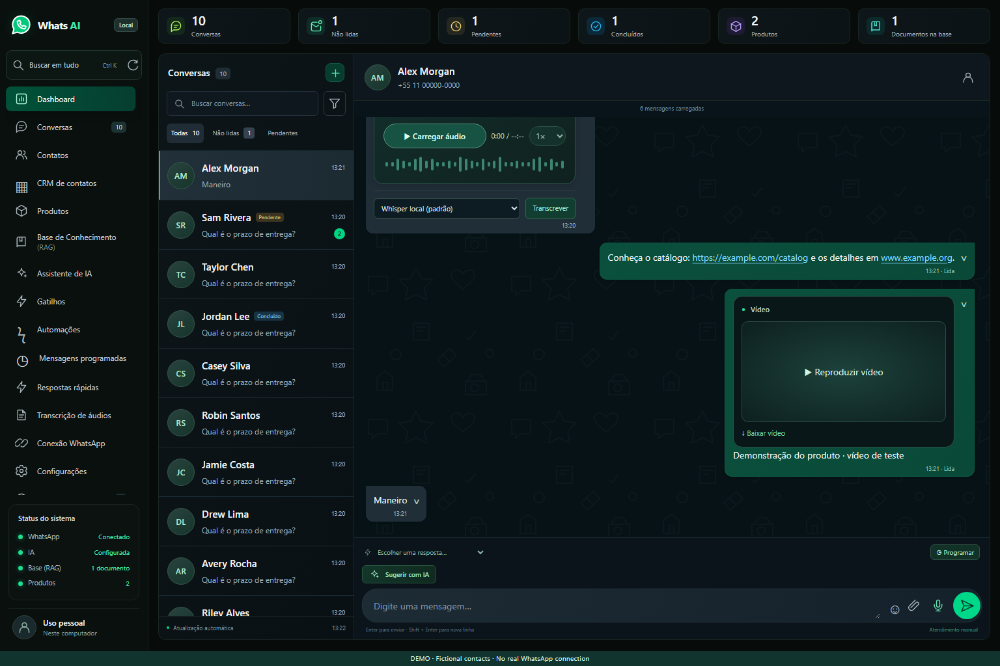
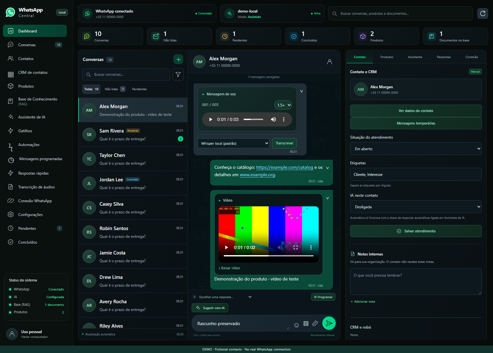
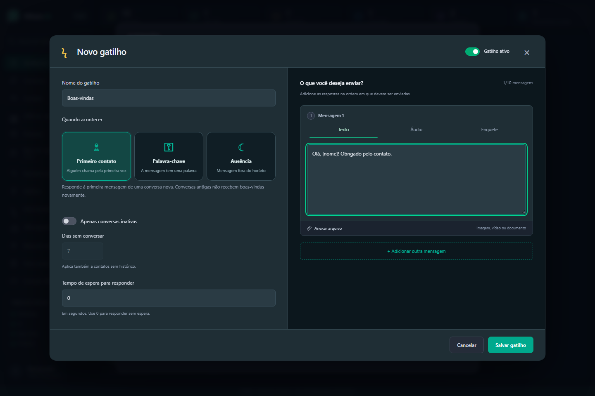
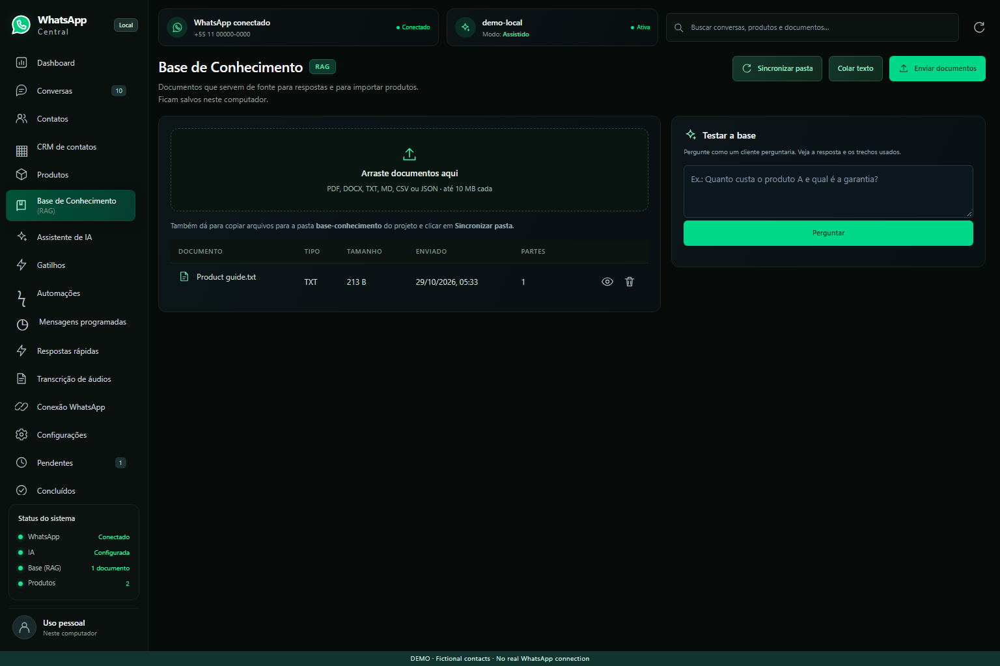
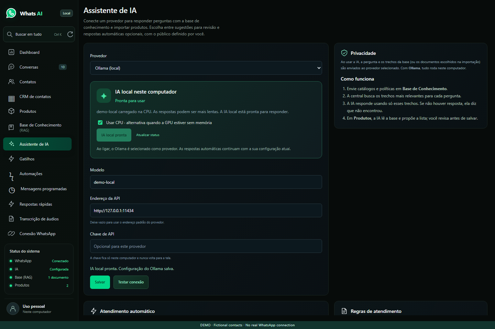
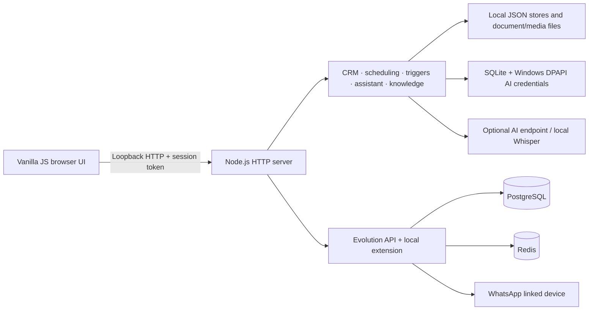

# WhatsApp Central

A local WhatsApp workspace for individual customer conversations, contact management, scheduled messages, automatic replies, and answers grounded in a product catalog and knowledge base.

Built with vanilla JavaScript and Node.js, with Evolution API running in Docker. The application is designed for a single Windows user: no hosted account, subscription layer, or public web server is required. The interface is in Brazilian Portuguese.

## Preview

These screenshots use the isolated demo with fictional contacts and sample content. They contain no production conversations, phone numbers, or credentials.

| Conversation workspace | Audio, video, and message actions |
| --- | --- |
|  |  |
| Automatic reply editor | Knowledge base |
|  |  |

## Try the demo

The demo needs Node.js 22 or later. It uses a temporary data directory and an in-process fake connector; it does not pair with WhatsApp, contact an AI provider, or send real messages. Background reply workers are disabled.

```powershell
npm ci
npm run demo
```

Open [the local demo](http://127.0.0.1:8876/). Stop it with **Ctrl+C**. Normal shutdown removes its temporary data. The demo does not read or change the production `data/` directory or Docker volumes.

## What it does

- **Conversations:** search and filter by name, phone, labels, unread state, and attendance status; load earlier messages; preserve drafts and scroll position during refreshes.
- **Messaging:** one attachment button for photos, videos, audio, documents and stickers; **Enter** sends and **Shift+Enter** inserts a line break. Insert quick replies, copy message text, forward supported content, use emoji, create polls, and delete your own messages for everyone when the connector accepts the request.
- **Media:** load audio on demand with seek and playback speed controls; start video with one explicit play action; display supported images and documents; transcribe audio with local Whisper or an explicitly selected OpenAI transcription service.
- **Contacts and CRM:** maintain status, labels, private notes, pipeline stage, follow-up information, and per-contact automation preferences. Display profile and business details when WhatsApp makes them available.
- **Scheduled messages:** persist a text message for a future instant, edit or cancel eligible jobs, and show an explicit uncertain state when delivery cannot be confirmed.
- **Automatic triggers:** configure first-contact, keyword, and outside-business-hours replies with optional inactivity filters, delays, and ordered response sequences. Responses can include text, audio, images, video, documents, or polls. Test saved rules without sending a message.
- **AI assistance:** request a draft or opt into automatic answers. Choose classified contacts, all eligible contacts, or genuinely new conversations admitted after activation. Use the catalog, retrieved knowledge, and editable service rules as context.
- **Knowledge and products:** import supported documents, inspect retrieved passages, manage product and service cards, and review AI-suggested catalog imports before saving.

Disappearing-message timers use native WhatsApp settings through the included connector extension. The interface checks connector capability and reports unavailable or unconfirmed operations; it does not simulate disappearing messages by removing local bubbles.

## Run with your WhatsApp account

### Requirements

- Windows with PowerShell.
- Node.js **22 or later** and npm.
- Docker Desktop configured for **Linux containers**.
- Internet access and a WhatsApp account available for linked-device pairing.
- Optional: Python, FFmpeg, and OpenAI Whisper for local audio transcription. Ollama is a separate optional installation for local AI answers.

### First start

```powershell
npm ci
npm start
```

The Windows launcher creates local connector credentials if none exist, starts Docker Desktop when needed, brings up the containers, starts the application in the background, and opens [WhatsApp Central](http://127.0.0.1:8766/). Existing configuration and pairing data are preserved.

In **Conexão WhatsApp**, choose **Conectar WhatsApp**. On the phone, open **Linked devices → Link a device**, then scan the QR code shown on the computer. Pairing survives ordinary restarts while its Docker volumes remain intact.

Other entry points:

| Command or launcher | Purpose |
| --- | --- |
| `npm run configure` | Generate missing initial configuration without replacing existing secrets. |
| `npm run serve` | Run only the Node server when configuration and the connector are already available. |
| `npm run shortcut` | Create the Windows desktop shortcut. |
| `Abrir WhatsApp.cmd` / `Iniciar WhatsApp.cmd` | Start the local stack and open the application. |
| `Parar WhatsApp.cmd` | Stop the application and containers while preserving data. |
| `Ativar inicio com Windows.cmd` | Opt into starting the services at Windows sign-in. |
| `Desativar inicio com Windows.cmd` | Remove that sign-in shortcut. |

The application listens on `127.0.0.1:8766`; Evolution API is published on `127.0.0.1:8767`. PostgreSQL and Redis have no published Windows ports. Keep the computer awake, Node running, Docker active, and WhatsApp connected for scheduling and automatic replies to work with the browser closed.

### Local transcription

Install FFmpeg on the Windows `PATH`, then prepare Whisper:

```powershell
python -m pip install openai-whisper
python -c "import whisper; whisper.load_model('base')"
```

The second command downloads the model. Configure model and language in **Transcrição de áudios**; the default is local Whisper `base` in Portuguese. Set `WHATSAPP_WHISPER_PYTHON` or `WHATSAPP_FFMPEG` before launching if the executables are in another location. The application first checks the standard Python 3.10 installation path, then `python.exe` on `PATH`.

Transcription accepts audio up to **10 MB and 10 minutes**, processes one job at a time, and allows up to 20 queued jobs. Temporary audio files are removed after processing. Interrupted or failed jobs require an explicit retry; local failures do not automatically send audio to a cloud provider.

## Automatic replies and scheduling

Automatic replies start **disabled**. Saving rules, selecting an AI audience, or opening a page does not turn them on. Enable each system's master switch deliberately. The existing keyword automation remains available alongside the richer trigger editor.

Trigger rules are evaluated in list order, and the first matching rule supplies the response sequence. Business hours include selected weekdays and an IANA time zone, with overnight schedules supported. An absence reply is triggered by an incoming message **outside** those hours; it is not a proactive scheduled broadcast. Optional inactivity means elapsed time since the preceding conversation message, not time since opening the interface.

Text responses accept `{name}` or `{nome}` to insert the contact's available display name. If a usable name is unavailable, the Portuguese fallback is “você”; private identifiers are not treated as names.

**Sugerir com IA** reads up to the latest 14 text messages from both sides of the selected conversation (bounded to 12,000 characters), including conversations where the last message was sent by the operator. The catalog and retrieved knowledge supplement that dialogue. A delayed suggestion is not inserted into a different chat or a draft edited during generation. Manual suggestions remain separate from automatic-reply eligibility.

AI audience options have distinct meanings:

| Audience | Eligibility |
| --- | --- |
| Classified contacts | Follow each contact's explicit draft or automatic classification. |
| All contacts | Include eligible individual contacts, including existing conversations, after opt-in. |
| New conversations | Admit contacts whose first incoming message arrives after activation and has no earlier incoming or outgoing conversation history. Admitted contacts continue to receive help on later messages. Being saved in the address book does not decide eligibility; existing conversations are excluded. |

Explicit **Off**, draft mode, and per-contact automation pauses remain effective. The assistant limits responses per contact, waits at least 20 seconds between answers, and allows at most six responses per hour. Unanswered questions can be handed off to an operator rather than invented. Reply workers coordinate message claims so a trigger, the keyword robot, and the assistant do not all answer the same incoming message. Old messages are not replayed as a catch-up campaign after startup or activation.

Scheduled jobs support **text only**. They continue while the browser is closed, but the local services must remain available. A disconnected job can wait up to 15 minutes after its due time; older jobs become missed and require rescheduling. Persisted send reservations reduce duplicate sends. If a process stops during delivery, the result can be **uncertain**: check WhatsApp before creating another send. The application does not promise exactly-once delivery across a remote connector.

## Knowledge retrieval and AI

The knowledge base accepts text-bearing **PDF, DOCX, TXT, Markdown, CSV, and JSON** files up to 10 MB, plus pasted text. Image-only scanned PDFs require OCR outside this application. Documents in [`base-conhecimento/`](base-conhecimento/) can be synchronized into the knowledge base; [`produtos-iniciais.json`](produtos-iniciais.json) supplies the initial catalog for a normal installation.

Retrieval splits documents into passages and ranks lexical matches with **BM25** after Portuguese-oriented normalization. This is keyword-based retrieval, not embedding-based semantic search. Relevance percentages are normalized retrieval scores, not calibrated confidence estimates. Without an AI provider, the application can still show the matching source passages.

In **Assistente de IA**, select **Ollama (local)** and click **Ligar IA local** to start the installed runtime in the background and load the chosen model. The status changes to **Pronta para usar** after the model is confirmed in memory. This selects the local provider without changing automatic-reply switches. The button uses loopback only, never downloads missing models automatically, and shows an installation message if Ollama or the model is missing. If the GPU has insufficient memory, select **Usar CPU** and start again. This saves the CPU preference for subsequent Ollama answers; CPU inference may be slower.



Provider adapters support OpenAI, Anthropic, Google Gemini, Ollama, and compatible endpoints. Model availability and credentials depend on the chosen provider. Questions, selected document passages, catalog context, and relevant conversation content may be sent to that configured endpoint when an AI feature runs. Transcription sends audio only when its cloud option is explicitly selected. With a local Ollama endpoint and local Whisper, those AI processing steps can remain on the machine; the WhatsApp connection still uses the network.

## Architecture



| Area | Implementation |
| --- | --- |
| Browser | [`public/`](public/): native DOM, CSS, and JavaScript; no frontend framework or build step. |
| HTTP boundary | [`server.cjs`](server.cjs): request validation, local-origin protections, connector calls, and service routing. |
| Connector adapter | [`lib/evolution.cjs`](lib/evolution.cjs): normalizes Evolution records, validates capabilities, and maps native operations. |
| Domain services | [`lib/`](lib/): independently testable workers for scheduling, triggers, assistant, CRM, transcription, and retrieval. |
| Persistence | [`lib/store.cjs`](lib/store.cjs): serialized updates and atomic JSON replacement; credentials use SQLite separately. |
| Infrastructure | [`infra/compose.yaml`](infra/compose.yaml): Evolution API 2.3.7, PostgreSQL 16, Redis 7, and persistent volumes. |
| Windows lifecycle | [`scripts/`](scripts/): configuration, start/stop, shortcuts, optional sign-in startup, and secret protection. |

The runtime has no npm framework dependencies. Playwright is a development dependency for browser tests. Background workers use local polling; no public webhook endpoint is required. The connector extension adds the supported native disappearing-message operation and capability metadata; stock connector deployments can report that feature as unavailable.

## Privacy and persistence

This is a local, single-user application, not a hardened multi-user service. The HTTP server binds to loopback, validates the host and origin, requires a per-process token for API access, and sets browser security headers. Exposing it through a reverse proxy or changing the bind address requires a separate authentication and deployment design.

AI credentials are encrypted in `data/credentials.sqlite` with **Windows DPAPI for the current Windows user**. The active assistant provider key and the OpenAI transcription key are stored separately; the interface receives only configured/not-configured information. Copying the database to another computer or user does not make those keys decryptable there. On unsupported platforms, credential protection fails explicitly; there is no plaintext fallback.

For older installations, the application migrates a plaintext assistant key from `data/ai.json` when it is accessed: it saves the protected value, verifies it can be read back, then removes the JSON field atomically. If protection or verification fails, the original file is preserved and the operation returns an error for a later retry. Existing backups are not rewritten by this migration.

Connector and container secrets remain local files (`data/config.json` and `infra/.env`). Those files are excluded from Git, but that exclusion is not encryption. Protect the Windows account and backups; do not share the data directory.

The main local files are:

| Location | Contents |
| --- | --- |
| `data/atendimento.json` | Contact metadata, CRM, quick replies, scheduling state, automation rules, send reservations, and transcription results. |
| `data/knowledge.json`, `data/knowledge/` | Knowledge documents and extracted text. |
| `data/produtos.json`, `data/product-images/` | Catalog and product images. |
| `data/ai.json` | Provider, model, and endpoint metadata; no API key after successful save or migration. |
| `data/credentials.sqlite` | Separate DPAPI-protected assistant and transcription credentials. |
| `data/config.json`, `infra/.env` | Generated connector and container configuration. |
| `data/*.log` | Local diagnostics. |

The connector session and synchronized messages reside in Docker volumes named under `whatsapp-local`. **Do not remove those volumes or use `docker compose down -v` for an ordinary stop.** Backing up the project directory alone does not back up the Docker database and pairing session. The internal Compose name stays stable to retain those volumes.

`data/`, connector environment files, logs, generated credentials, and dependencies are excluded from version control. The committed demo and test fixtures use fictional contacts. On Windows installations with HTTPS inspection, the optional trust helper exports a public certificate from an already trusted Windows root; it keeps TLS verification enabled and does not export a private key.

## Validation

```powershell
npm test
npx playwright install chromium
npm run test:e2e
```

The Node suite covers domain behavior, HTTP contracts, persistence, retries and uncertain delivery, frontend state, and credential handling. The browser suite uses an isolated fixture server and fake connectors. Neither suite needs a paired WhatsApp session or sends messages to real contacts. The Windows DPAPI test is skipped on non-Windows platforms.

See [`docs/testing.md`](docs/testing.md) for the validation scope, fixture boundaries, and manual checks. A passing fake-connector test verifies the application contract; it does not prove that an upstream WhatsApp session will accept every operation.

## Current limits

- Individual conversations only; no bulk campaigns, group management, billing, or multi-user permissions.
- History is limited to what the linked device and connector synchronize. Private `@lid` identifiers may lack a public phone number or address-book name; the application does not guess a mapping.
- Media and forwarding are limited to supported types and 10 MB. Forwarding recreates content as a new message; Evolution 2.3.7 does not provide the native forwarded badge through this workflow.
- Scheduling is local and text-only. Sleep, network outages, WhatsApp disconnection, or stopped services affect delivery.
- Native delete, poll, sticker, profile, and disappearing-message operations depend on WhatsApp and connector support. Unsupported or unconfirmed operations return an error instead of fabricated success.
- A local JSON store is appropriate for this single-user deployment; it is not a shared transactional database for several application processes.
- Cloud AI answers and imported catalog suggestions require review appropriate to the task. Retrieval is lexical and can miss differently worded information.
- AI credentials are bound to the Windows user and machine. Re-enter keys after moving to another account or computer; a copied SQLite database alone cannot restore access.

For local diagnostics:

```powershell
docker compose -f infra/compose.yaml ps
docker compose -f infra/compose.yaml logs --tail=50 evolution
```

Inspect `data/server.err.log` for application startup failures. Keep logs and local data private when sharing an issue.
