# Whats AI

A local WhatsApp workspace for individual customer conversations, contact management, scheduled messages, automatic replies, and answers grounded in a product catalog and knowledge base.

Built with vanilla JavaScript and Node.js, with Evolution API running in Docker. The application is designed for one local Windows installation: no hosted account, subscription layer, or public web server is required. Named attendants can organize conversations, but they do not have individual authenticated accounts. The interface is in Brazilian Portuguese.

**Start here:** [Isolated demo](#try-the-demo) · [Architecture](#architecture) · [Trade-offs](#design-trade-offs) · [Validation](#validation)

## Preview

These screenshots use the isolated demo with fictional contacts and sample content. They contain no production conversations, phone numbers, or credentials.

| Conversation workspace | Audio, video, and message actions |
| --- | --- |
| 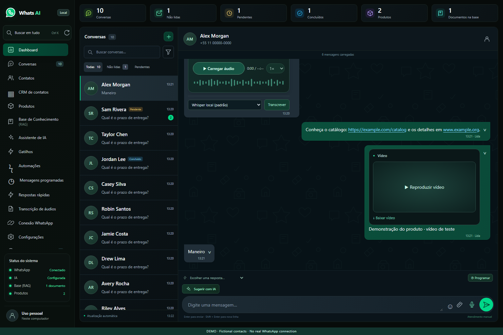 | 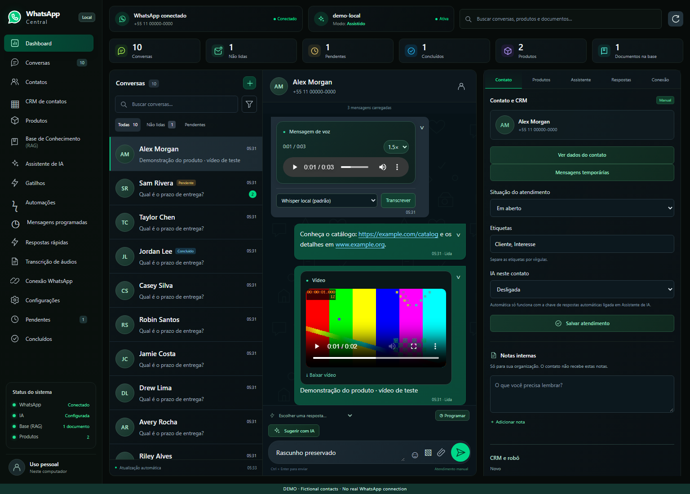 |
| Automatic reply editor | Knowledge base |
| 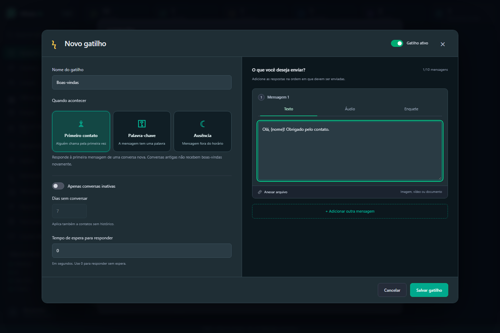 | 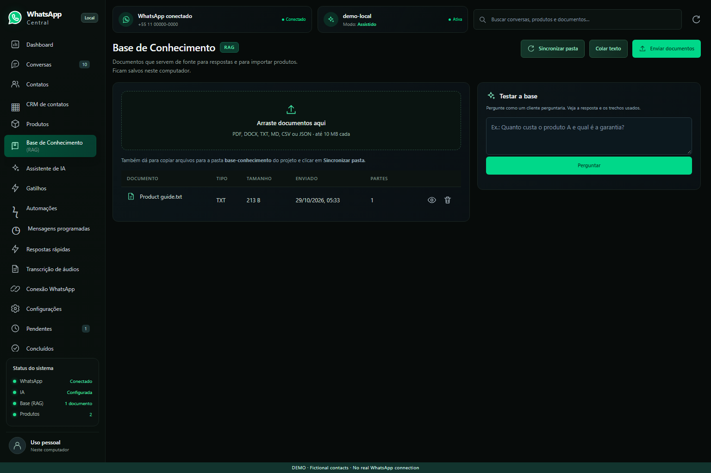 |
| Voice message review | In-app PDF reader |
| 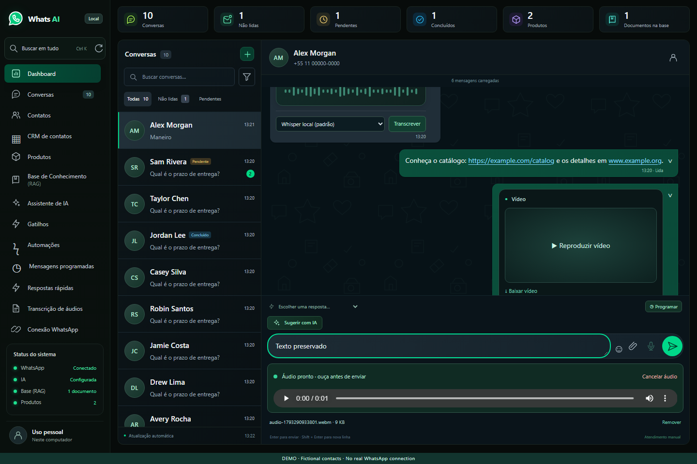 | 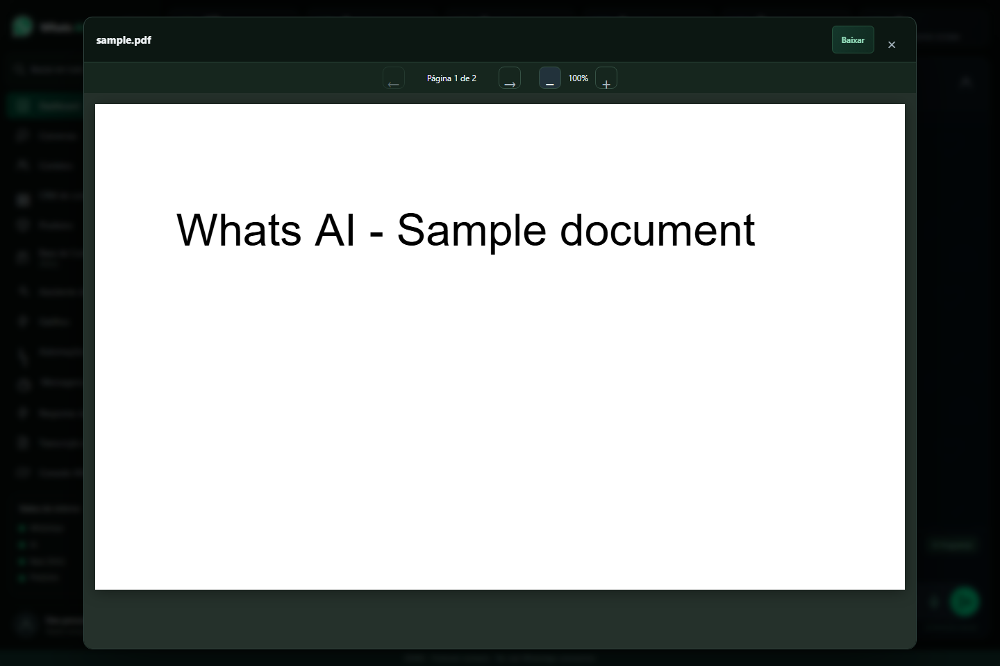 |
| Replies, reactions, edits, location and contact cards | Voice flow: transcription → AI reading → text or voice reply |
| 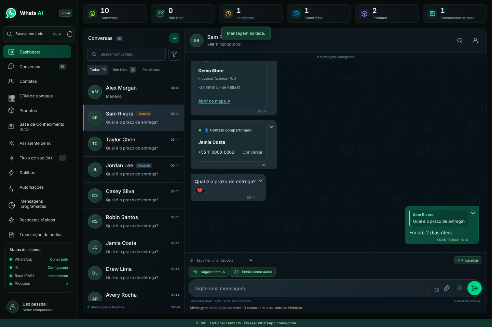 | 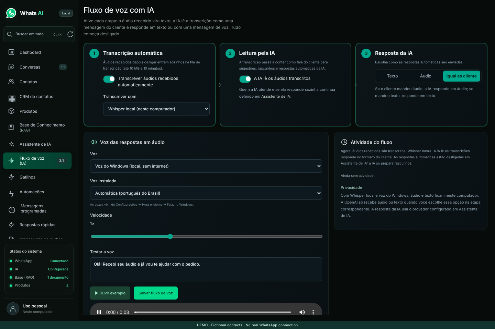 |
| Team dashboard | |
| 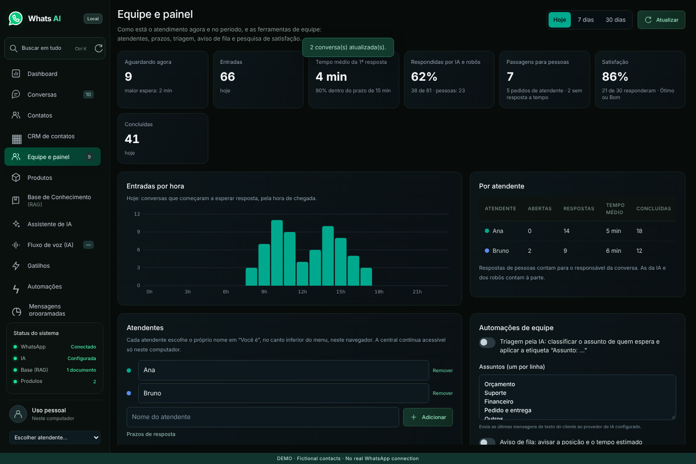 | |

## Try the demo

The demo needs Node.js 22.13 or later. It uses a temporary data directory and an in-process fake connector; it does not pair with WhatsApp, contact an AI provider, or send real messages. Background reply workers are disabled.

```powershell
npm ci
npm run demo
```

Open [the local demo](http://127.0.0.1:8876/). Stop it with **Ctrl+C**. Normal shutdown removes its temporary data. The demo does not read or change the production `data/` directory or Docker volumes.

## What it does

- **Conversations:** an expanded conversation column with contact/CRM tools available in a closable details panel. Search and filter by name, phone, labels, unread state, and attendance status; preserve drafts and scroll position during refreshes. Open global search from the sidebar or with **Ctrl+K**.
- **Messaging:** one attachment button for photos, videos, audio, documents and stickers; **Enter** sends and **Shift+Enter** inserts a line break. Insert quick replies, copy message text, forward supported content, use emoji, create polls, and delete your own messages for everyone when the connector accepts the request.
- **WhatsApp features:** reply to a specific message (quoted), react with emoji, edit your own texts within WhatsApp's 15-minute window, share a location (typed coordinates or the browser's location) or a contact card, and open received locations and contact cards. Pin up to three conversations, mute (8 hours, 1 week, always), archive, mark as unread, block/unblock, star messages, search inside the loaded conversation, and get optional desktop notifications and sound. The contact sees "typing…" and "recording audio…" while you write or record (can be turned off). Edit your own WhatsApp name, about text, photo and privacy settings in **Meu perfil e privacidade**.
- **Media:** record voice messages from the composer, review playback, then explicitly send or discard. Recordings are sent as native WhatsApp voice notes (PTT). Choose **Enviar como texto** to preview and edit the local Whisper transcription, then select **Enviar texto** to send it. Tap **1** while recording or previewing audio, photos or videos to enable WhatsApp view once for that item. Recordings require browser microphone permission and stop at five minutes or the attachment size limit. Load received audio with seek/speed controls, start video with one play action, enlarge supported images, and read PDFs in the app with page/zoom controls. PDF rendering uses locally served [Mozilla PDF.js](https://mozilla.github.io/pdf.js/); documents are not uploaded to another viewer. Transcribe audio with local Whisper or an explicitly selected OpenAI transcription service.
- **Media previews:** received images show an inline preview automatically. Videos display their cover, name and duration when the connector provides those fields; the full video loads only after an explicit play action. Selected photos and videos show a local preview before sending, and removing or replacing the attachment releases its temporary URL.
- **Contacts and CRM:** **Contatos** lists the WhatsApp address book together with conversations (a phone number and a private `@lid` identifier of the same person count once, with the known phone shown), 200 at a time with search and status filters; contacts without a conversation open a new one. Maintain status, labels, private notes, pipeline stage, follow-up information, and per-contact automation preferences. Display profile and business details when WhatsApp makes them available.
- **Scheduled messages:** persist a text message for a future instant, edit or cancel eligible jobs, and show an explicit uncertain state when delivery cannot be confirmed.
- **Automatic triggers:** configure first-contact, keyword, and outside-business-hours replies with optional inactivity filters, delays, and ordered response sequences. Responses can include text, audio, images, video, documents, or polls. Test saved rules without sending a message.
- **Team operation:** an **Aguardando** queue ordered by waiting time with green/yellow/red response deadlines, attendants responsible for conversations (with transfer notes and a **Minhas** filter), bulk actions (close, pending, label, assign, mark read, archive), quick replies with `/` in the editor, and **Equipe e painel** with arrivals per hour, first-response time, the share answered by AI/robots versus people, handoffs and satisfaction. Optional AI triage, queue position notices and a satisfaction poll on closing start disabled.
- **Voice flow:** turn on, separately, (1) automatic transcription of received audio, (2) the AI reading those transcriptions as customer messages, and (3) AI replies as text, as voice notes, or in the same format the customer used. Voice replies use an installed Windows voice (local) or OpenAI text-to-speech. **Enviar como áudio** turns the editor text into a voice note manually.
- **AI assistance:** request a draft or opt into automatic answers. Choose classified contacts, all eligible contacts, or genuinely new conversations admitted after activation. Use the catalog, retrieved knowledge, and editable service rules as context.
- **Knowledge and products:** import supported documents, inspect retrieved passages, manage product and service cards, and review AI-suggested catalog imports before saving.

Disappearing-message timers use native WhatsApp settings through the included connector extension. The interface checks connector capability and reports unavailable or unconfirmed operations; it does not simulate disappearing messages by removing local bubbles.

## Run with your WhatsApp account

### Requirements

- Windows with PowerShell.
- Node.js **22.13 or later** and npm.
- Docker Desktop configured for **Linux containers**.
- Internet access and a WhatsApp account available for linked-device pairing.
- Optional: Python, FFmpeg, and OpenAI Whisper for local audio transcription. Ollama is a separate optional installation for local AI answers.

### First start

```powershell
npm ci
npm start
```

The Windows launcher creates local connector credentials if none exist, starts Docker Desktop when needed, brings up the containers, starts the application in the background, and opens [Whats AI](http://127.0.0.1:8766/). Existing configuration and pairing data are preserved.

In **Conexão WhatsApp**, choose **Conectar WhatsApp**. On the phone, open **Linked devices → Link a device**, then scan the QR code shown on the computer. Pairing survives ordinary restarts while its Docker volumes remain intact.

### Several WhatsApp accounts

Use the account button at the top of the sidebar to see the status of every account, add another one, or switch between them. Each account is its own Evolution instance, paired with its own QR code. The original account keeps its instance and session; its former `data/atendimento.json` state is migrated to PostgreSQL. Updating requires no new pairing.

| Per account | Shared by all accounts |
| --- | --- |
| Conversations, contacts, CRM, quick replies, scheduled messages, triggers, automations, assistant rules and activity, team queue and dashboard, voice flow, human-timing and transcription settings, real-time connector events | Knowledge base, product catalog, AI provider and keys, voices |

Everything a browser tab sends goes through the account that tab is showing; switching reloads the page, and a tab keeps its account. **Desconectar** ends only that account's session and keeps its data. **Remover** deletes that instance from the connector, including its synchronized messages, and exports its local attendance data to `data/contas-arquivadas/`. The last remaining account cannot be removed. If the same number is paired in two accounts, the list shows a warning because automatic replies could be sent twice.

Local integrations with the `X-Integration-Token` header use the first account unless they send `X-WhatsApp-Account` with an account ID. Responses carry the account used in the header of the same name, and an unknown ID returns 404 instead of falling back to another account.

Other entry points:

| Command or launcher | Purpose |
| --- | --- |
| `npm run configure` | Generate missing initial configuration without replacing existing secrets. |
| `npm run serve` | Run only the Node server when configuration and the connector are already available. |
| `npm run shortcut` | Create the **Whats AI** desktop shortcut and migrate the previous app shortcut when owned by this project. |
| `Iniciar WhatsApp Local.cmd` / `npm start` | Start the local stack and open the application. Existing `Abrir WhatsApp.cmd` and `Iniciar WhatsApp.cmd` launchers remain compatible. The launcher restarts an older running build after an update. |
| `Parar WhatsApp.cmd` | Stop the application and containers while preserving data. |
| `Ativar inicio com Windows.cmd` | Opt into starting the services at Windows sign-in. |
| `Desativar inicio com Windows.cmd` | Remove that sign-in shortcut. |

The application listens on `127.0.0.1:8766`; Evolution API is published on `127.0.0.1:8767`. PostgreSQL and Redis have no published Windows ports. Keep the computer awake, Node running, Docker active, and WhatsApp connected for scheduling and automatic replies to work with the browser closed.

### Local transcription

Install FFmpeg on the Windows `PATH`, then prepare Whisper:

```powershell
python -m pip install openai-whisper
python -c "import whisper; whisper.load_model('base')"
```

The second command downloads the model. Configure model and language in **Transcrição de áudios**; the default is local Whisper `base` in Portuguese. Set `WHATSAPP_WHISPER_PYTHON` or `WHATSAPP_FFMPEG` before launching if the executables are in another location. The application first checks the standard Python 3.10 installation path, then `python.exe` on `PATH`.

Transcription accepts audio up to **10 MB and 10 minutes**. In **Transcrição de áudios** you choose how many audios run at the same time (1 to 4; each local job uses up to 4 CPU cores) and the queue limit (10 to 500, default 100). Temporary audio files are removed after processing.

For faster CPU transcription, install [faster-whisper](https://github.com/SYSTRAN/faster-whisper) and download the model once, then select **faster-whisper** as the local engine. The central only uses models already on disk; it never downloads one during a transcription.

```powershell
python -m pip install faster-whisper
python -c "from faster_whisper import WhisperModel; WhisperModel('base')"
```
 Interrupted or failed jobs require an explicit retry; local failures do not automatically send audio to a cloud provider.

## Automatic replies and scheduling

Automatic replies start **disabled**. Saving rules, selecting an AI audience, or opening a page does not turn them on. Enable each system's master switch deliberately. The existing keyword automation remains available alongside the richer trigger editor.

Trigger rules are evaluated in list order, and the first matching rule supplies the response sequence. Business hours include selected weekdays and an IANA time zone, with overnight schedules supported. An absence reply is triggered by an incoming message **outside** those hours; it is not a proactive scheduled broadcast. Optional inactivity means elapsed time since the preceding conversation message, not time since opening the interface.

Text responses accept `{name}` or `{nome}` to insert the contact's available display name. If a usable name is unavailable, the Portuguese fallback is “você”; private identifiers are not treated as names.

**Sugerir com IA** reads up to the latest 14 text messages from both sides of the selected conversation (bounded to 12,000 characters), including conversations where the last message was sent by the operator. The catalog and retrieved knowledge supplement that dialogue. A delayed suggestion is not inserted into a different chat or a draft edited during generation. Manual suggestions remain separate from automatic-reply eligibility.

AI audience options have distinct meanings:

| Audience | Eligibility |
| --- | --- |
| Classified contacts | Follow each contact's explicit draft or automatic classification. |
| All contacts | Include eligible individual contacts, including existing conversations, after opt-in. |
| New conversations | Admit contacts whose first incoming message arrives after activation and has no earlier incoming or outgoing conversation history. Admitted contacts continue to receive help on later messages. Being saved in the address book does not decide eligibility; existing conversations are excluded. |

Explicit **Off**, draft mode, and per-contact automation pauses remain effective. The assistant limits responses per contact, waits at least 20 seconds between answers, and allows at most six responses per hour. Unanswered questions can be handed off to an operator rather than invented. Reply workers coordinate message claims so a trigger, the keyword robot, and the assistant do not all answer the same incoming message. Old messages are not replayed as a catch-up campaign after startup or activation.

### Many messages at once

Conversations are handled in parallel: up to **4 AI generations** and **6 sends** run at the same time, with at most one task per contact, so one customer's "human" wait and typing indicator no longer hold everyone else. Triggers keep priority over the keyword robot and the assistant: each worker claims messages during its scan, in that order, and only the waiting, generation and sending happen in the background.

An automatic reply must still leave within **15 minutes** of the customer's message. When it cannot (a long AI queue, a slow local model, an AI error, or an audio still waiting for transcription), the conversation becomes **Pendente** with the label **Sem resposta**, and the activity log says why. Nothing is sent late. The **Sem resposta** filter in the conversation list shows these conversations, longest wait first. The label is removed when you (or a later automatic reply) answer the conversation. In draft mode, the AI only logs the problem; you are already answering.

**Synchronization.** The connector's conversation listing scans all stored messages, so the central no longer asks for it on every check. All workers and the browser share one list, refreshed in full every 30 seconds and, in between, only for conversations with recent messages. Checks right before a send query just that conversation. The browser receives only the conversations that changed, and lists above 250 conversations draw only the visible rows. The central also listens to the connector's real-time events over a local WebSocket (`WEBSOCKET_ENABLED` in [`infra/compose.yaml`](infra/compose.yaml); restart through the launcher once to apply it): each new message starts a cycle immediately, and polling every 15 seconds remains as a fallback (5 seconds without events). The sidebar shows **Tempo real** while events arrive.

<details>
<summary>Previously reported simulation observations</summary>

The following figures are historical development observations. A reproducible fixture command, measurement date and source revision are not recorded alongside them, so they should not be treated as a current benchmark or a production-capacity promise.

In a reported 30-second simulation with 3,000 conversations and the browser open, the connector served 1 full listing instead of 14 (0.8 MB instead of 11.8 MB), and the interface had no blocked frames instead of 1.9 seconds blocked; with 8,000 conversations, 2.3 MB instead of 31.6 MB and no blocking instead of 9.9 seconds.

In a reported simulated burst with the default "parecer humano" settings, 60 simultaneous customers were all answered within 1.5 minutes using a ~4-second cloud model, and within 5.3 minutes using a ~20-second local model; 200 customers within 4.7 minutes with the cloud model. The previous sequential worker answered 49 of 60 (cloud) and 26 of 60 (local), and silently skipped the rest. Real throughput depends on the AI provider, the connector and WhatsApp.

</details>

Scheduled jobs support **text only**. They continue while the browser is closed, but the local services must remain available. A disconnected job can wait up to 15 minutes after its due time; older jobs become missed and require rescheduling. Persisted send reservations reduce duplicate sends. If a process stops during delivery, the result can be **uncertain**: check WhatsApp before creating another send. The application does not promise exactly-once delivery across a remote connector.

## Team operation

Open **Equipe e painel**. Everything that writes to customers starts **off**.

| Tool | What it does |
| --- | --- |
| **Aguardando** | Conversations whose latest message is from the customer, oldest wait first. Each row shows the wait with the deadlines set in the panel (default: attention after 5 minutes, late after 15). A conversation leaves the queue when anyone answers, or when it is closed. Reactions, poll votes and system messages do not open a wait. |
| Attendants | Names for the people sharing this central. Each person picks **Você é** in the sidebar on their browser; **Responsável** in the contact panel assigns a conversation, and a change writes an internal note such as “Transferida de Ana para Bruno por Carla”. **Minhas** lists your open conversations. |
| Bulk actions | The check button above the list selects conversations (up to 200 per action): close, mark pending, add or remove a label, assign, mark as read, archive. |
| Quick replies with `/` | Type `/` at the start of a line in the editor to search the quick replies; Enter or Tab inserts one, and `{nome}` becomes the contact's first name. |
| Dashboard | Today, 7 or 30 days: arrivals (conversations that started waiting), average first-response time and the share within the deadline, answered by AI/robots versus by people, handoffs (AI asked for a person or **Sem resposta**), satisfaction, closed conversations and per-attendant numbers. Arrivals per hour show as a column chart with exact values on hover and an accessible table. People's replies count for the conversation's attendant. |
| AI triage | Classifies who is waiting into the subjects you list and applies the label `Assunto: …`. It sends the customer's latest text messages to the configured AI provider, at most once a day per conversation. |
| Queue notice | After the chosen wait (default 90 seconds), sends “you are number N, estimated time …” once per wait, based on the last 7 days' average response time. It is never sent when the AI will answer by itself, nor to paused or blocked contacts, and it does not count as an answer. |
| Satisfaction poll | When enabled, closing a conversation (manually or in bulk) sends a native WhatsApp poll (Ótimo, Bom, Regular, Ruim). A recorded send within the previous 24 hours prevents another poll for that contact. Votes count toward the dashboard's satisfaction (Ótimo or Bom). |

Numbers start counting from the moment this version runs; conversations that were already waiting appear in the queue without being counted as new arrivals. Daily figures are kept for 90 days in `data/central.sqlite`.

## Voice flow

Open **Fluxo de voz (IA)**. Every stage starts **off** and is saved separately:

| Stage | What it does | Where data goes |
| --- | --- | --- |
| 1. Automatic transcription | Incoming audio messages received after activation (and within the last 2 hours) are queued once each, up to five per cycle, using the normal transcription limits. | Local Whisper by default; OpenAI only if selected for this stage. |
| 2. AI reading | Completed transcriptions count as customer speech, marked as `[áudio transcrito]`, for suggestions, drafts and automatic replies. An audio is answered only after its transcription is complete. | The configured assistant provider receives the transcription text, as it does for typed messages. |
| 3. AI reply format | **Texto**, **Áudio** or **Igual ao cliente** (voice note when the customer sent audio, text otherwise). | Windows voice stays local; OpenAI voice receives the reply text. |

Who the AI serves and whether it answers on its own still come from **Assistente de IA**: with the master switch off, the AI only prepares drafts. If voice generation fails before sending, the reply is sent as text and the event is logged in the voice flow activity. Voice replies accept up to 1,500 characters; links are read as "link enviado na conversa" and emojis are not spoken. Text the central sent as audio is kept so the AI can follow the conversation.

The Windows voice uses `System.Speech` through [`scripts/speak.ps1`](scripts/speak.ps1) and prefers an installed `pt-BR` voice (add one in **Settings → Time & language → Speech**). OpenAI voices use `/v1/audio/speech` (`gpt-4o-mini-tts`, `tts-1` or `tts-1-hd`) with the same protected OpenAI key used by AI transcription. Generated audio is sent with the connector's voice-note conversion (OGG/Opus).

## Knowledge retrieval and AI

The knowledge base accepts text-bearing **PDF, DOCX, TXT, Markdown, CSV, and JSON** files up to 10 MB, plus pasted text. Image-only scanned PDFs require OCR outside this application. Documents in [`base-conhecimento/`](base-conhecimento/) can be synchronized into the knowledge base; [`produtos-iniciais.json`](produtos-iniciais.json) supplies the initial catalog for a normal installation.

Retrieval splits documents into passages and combines two rankings with Reciprocal Rank Fusion: **BM25** keyword matches after Portuguese-oriented normalization, and **embedding** similarity, which finds passages that share a meaning but no words with the question. Relevance percentages are normalized retrieval scores, not calibrated confidence estimates.

Vectors are generated in the background and saved per document in `data/central.sqlite`, so restarts reuse them and only new or changed documents are processed. Changing the embedding model rebuilds the index.

| Provider | Default embedding model |
| --- | --- |
| OpenAI | `text-embedding-3-small` |
| Google Gemini | `gemini-embedding-001` |
| Ollama | `bge-m3` (install it with `ollama pull bge-m3`) |
| Anthropic | No embedding API: `bge-m3` through local Ollama |
| Compatible endpoint | Set **Modelo de embeddings** in **Assistente de IA** |

Set **Modelo de embeddings** to another model, or to `off` to keep keyword-only retrieval. If the model is missing, a document is still being indexed, or the provider fails, those searches fall back to BM25, the knowledge page shows the reason, and indexing retries after five minutes. Without an AI provider, the application can still show the matching source passages.

In **Assistente de IA**, select **Ollama (local)** and click **Ligar IA local** to start the installed runtime in the background and load the chosen model. The status changes to **Pronta para usar** after the model is confirmed in memory. This selects the local provider without changing automatic-reply switches. The button uses loopback only, never downloads missing models automatically, and shows an installation message if Ollama or the model is missing. If the GPU has insufficient memory, select **Usar CPU** and start again. This saves the CPU preference for subsequent Ollama answers; CPU inference may be slower.

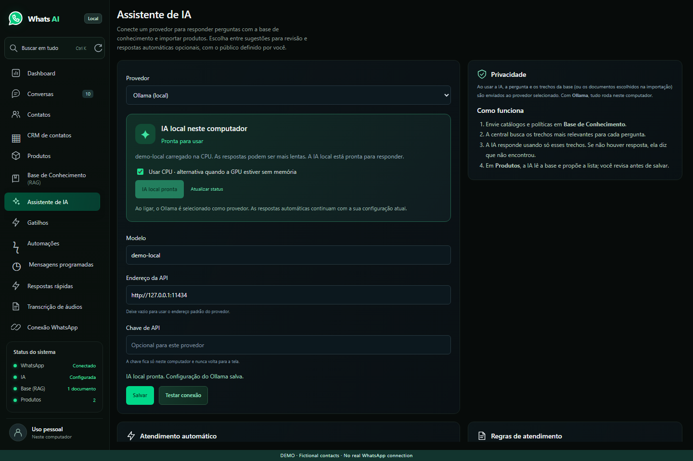

### Answer reliability

Each retrieved passage gets a confidence level. **High** means both searches agree, the embedding similarity is well above the model's cutoff, or, without embeddings, most of the question's words appear in the passage. **Medium** means only one search found it. **Low** means a weak keyword match. Choose how much of that reaches the AI in **Base de Conhecimento → Confiabilidade das respostas**. The choice applies to questions on that page, manual suggestions and automatic replies:

| Level | Passages sent to the AI | Behavior |
| --- | --- | --- |
| Rigorosa | High only, up to 3 | Instructs the AI to use explicit context and hand off to an operator when it cannot support an answer. |
| Equilibrada (default) | High and medium, up to 4 | Balances retrieval coverage with the confidence filter. |
| Flexível | All levels, up to 6, with a lower semantic cutoff | Allows greetings and general questions while instructing the AI to ground business facts in the base. |

The answer panel shows the search confidence and the level used. These labels describe retrieval agreement, not a calibrated probability that the answer is correct; prompt instructions do not guarantee factual answers.

### Robot suggestions from your business

In **Automações**, **Gerar sugestões com IA** reads the knowledge base and catalog and proposes frequent customer questions with keywords and short answers. Each suggestion shows the passage that supports its answer, or a warning when none was found, and flags keywords that an existing rule already uses. **Adicionar como regra** adds it to the rule list **switched off**; nothing is saved or sent until you review it, mark **Regra ativa** and click **Salvar regras**. With local AI on the CPU, generation can take a few minutes.

### Set up the knowledge base for any business

```powershell
npm run rag:configurar
```

The wizard asks for the business name and type (restaurant, shop, clinic, salon, repair shop, gym, school, services or other), then opening hours, address, payment, products and prices, policies and type-specific topics. It writes `base-conhecimento/00-sobre-o-negocio.md`, creates customer-style test questions in `base-conhecimento/testes/perguntas.txt` (the `testes` folder is not imported into the base), checks the embedding model and offers to download a missing local model with `ollama pull`, then synchronizes the folder and runs retrieval checks. When the app is open it works through the local API; when it is closed it prepares the data folder directly. These commands use the installation's knowledge and data folders, not the isolated demo. `npm run rag:configurar -- --respostas respostas.json` runs without prompts and replaces an existing business-profile file.

```powershell
npm run rag:testar
npm run rag:testar -- --pergunta "Vocês entregam no meu bairro?" --confiabilidade strict
```

`rag:testar` prints, for each question, the confidence, the document and the start of the passage found, plus a summary. Questions with no passage identify topics or wording to investigate. This checks retrieval, not the factual accuracy of generated answers. Both commands can refresh the embedding index and use the configured provider even while the app is closed; see [`scripts/rag-lib.cjs`](scripts/rag-lib.cjs).

The **Assistente de IA** page offers OpenAI, Anthropic (Claude), Google Gemini, DeepSeek, Groq, Mistral AI, xAI (Grok), OpenRouter, Together AI, Perplexity, Ollama, and custom OpenAI-compatible endpoints. Choose a provider, paste its key, and click **Carregar modelos do provedor** to retrieve the conversation models available to that account (or installed in Ollama). This explicit catalog query uses the pasted or saved key without saving a new key or changing the active assistant. Initial suggestions are not a guarantee of account access. Providers without a model-list endpoint can use the suggestions or **Informar outro modelo…** for an exact model identifier, including private models. Click **Salvar** to persist the configuration and encrypt the key; a blank key preserves the key already saved for that provider. Changing providers clears pasted credentials and the previous API address from the form.

Model availability and credentials depend on the chosen provider. Questions, selected document passages, catalog context, and relevant conversation content may be sent to that configured endpoint when an AI feature runs. Transcription sends audio only when its cloud option is explicitly selected. With a local Ollama endpoint and local Whisper, those AI processing steps can remain on the machine; the WhatsApp connection still uses the network.

## Architecture

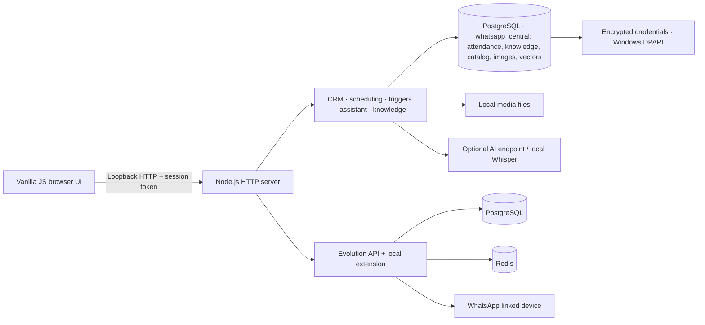

| Area | Implementation |
| --- | --- |
| Browser | [`public/`](public/): native DOM, CSS, and JavaScript; no frontend framework or build step. |
| HTTP boundary | [`server.cjs`](server.cjs): request validation, local-origin protections, connector calls, and service routing. |
| Connector adapter | [`lib/evolution.cjs`](lib/evolution.cjs): normalizes Evolution records, validates capabilities, and maps native operations. |
| Domain services | [`lib/`](lib/): independently testable workers for scheduling, triggers, assistant, CRM, transcription, retrieval, the voice flow ([`lib/voice-flow.cjs`](lib/voice-flow.cjs)) and speech ([`lib/speech.cjs`](lib/speech.cjs)). |
| Team | [`lib/team.cjs`](lib/team.cjs): waiting queue, daily metrics, triage, queue notices, satisfaction polls and bulk actions; [`public/team.js`](public/team.js) holds the queue filters, `/` replies, assignment and dashboard. |
| Synchronization | [`lib/evolution.cjs`](lib/evolution.cjs) shares an incremental conversation list and single-conversation lookups; [`lib/evolution-events.cjs`](lib/evolution-events.cjs) is a minimal Socket.IO client for connector events (Node's built-in WebSocket); [`lib/chat-delta.cjs`](lib/chat-delta.cjs) sends the browser only changed conversations. |
| WhatsApp operations | [`lib/messaging-routes.cjs`](lib/messaging-routes.cjs): replies, reactions, edits, location, contact, voice notes, presence, chat organization, starred messages, profile and privacy. |
| Persistence | [`lib/postgres.cjs`](lib/postgres.cjs): the running central keeps attendance, accounts, knowledge, catalog, images, vectors and DPAPI-encrypted credentials in a dedicated PostgreSQL database. [`lib/store.cjs`](lib/store.cjs) and [`lib/database.cjs`](lib/database.cjs) keep the same interface on `data/central.sqlite` for tests and the demo. |
| Infrastructure | [`infra/compose.yaml`](infra/compose.yaml): Evolution API 2.3.7, PostgreSQL 16, Redis 7, and persistent volumes. |
| Windows lifecycle | [`scripts/`](scripts/): configuration, start/stop, shortcuts, optional sign-in startup, and secret protection. |

The runtime uses `pg` for PostgreSQL and `pdfjs-dist` for PDF rendering; it has no frontend framework. Playwright is a development dependency for browser tests. Background workers use local polling; no public webhook endpoint is required. The connector extension adds the supported native disappearing-message operation and capability metadata; stock connector deployments can report that feature as unavailable.

## Design trade-offs

These trade-offs describe the implemented architecture and its boundaries. The recorded simulation figures above are workload-specific observations, not production capacity guarantees.

| Choice | Benefit | Cost or boundary |
| --- | --- | --- |
| Loopback-only Windows application with attendant labels | Keeps account configuration and the workspace on one machine while supporting assignment and queue metrics. | Attendant names do not enforce identity or permissions. Scheduling depends on the machine, Node and Docker remaining available; this is not a hosted multi-user service. |
| Vanilla browser UI and Node server | Avoids a frontend build pipeline and keeps local installation direct. | UI state, rendering performance and accessibility must be managed explicitly as the interface grows. |
| SQLite persistence plus Windows DPAPI for AI credentials | Persists local work and binds protected credentials to the Windows account. | The store targets one application process; moving a database does not migrate usable credentials to another machine/user. |
| Evolution linked-device connector | Provides conversation/media operations through a local integration boundary. | History, delivery acknowledgments and native feature support depend on WhatsApp and the connector. An ambiguous send cannot be treated as exactly once. |
| Hybrid BM25 and embedding retrieval with a keyword fallback | Combines exact vocabulary and semantic matches while retaining retrieval during embedding failures. | Indexing adds latency, storage and provider cost; cloud embeddings transmit document passages to that provider. Retrieval scores are not calibrated confidence. |
| Explicit automation switches, per-contact coordination and deadlines | Separates manual suggestions from automatic sending and reduces competing replies. | Missed or uncertain work needs operator review; local claims cannot make a remote send and local persistence one atomic transaction. |

For a technical walkthrough, follow [message routing](lib/messaging-routes.cjs), [reply coordination](lib/concurrency.cjs), [scheduling](lib/scheduler.cjs), [team queues and metrics](lib/team.cjs), [knowledge retrieval](lib/knowledge.cjs), [embeddings](lib/embeddings.cjs) and [credential storage](lib/credentials.cjs), then compare those boundaries with [the testing guide](docs/testing.md).

## Privacy and persistence

**Where data lives.** Central data uses one SQLite database, `data/central.sqlite`, built into Node.js: no extra service, port, password or npm dependency, and the central still opens while Docker is stopped. Messages and the WhatsApp session stay in the connector's PostgreSQL inside Docker, managed by Evolution API. Sharing the central across computers would require a separate persistence, authentication and deployment design; the current attendant labels do not provide those boundaries. To back up, stop the central and copy `data/` together with the Docker volumes.

This is a local application without per-person authentication. The HTTP server binds to loopback, validates the host and origin, requires a per-process token for API access, and sets browser security headers. Exposing it through a reverse proxy or changing the bind address requires a separate authentication and deployment design.

Production stores the central's account registry, contact/CRM metadata, scheduling, automation, send reservations, transcription results, AI configuration, products and knowledge text in the dedicated **`whatsapp_central` PostgreSQL database**, using its own non-superuser login. The Evolution connector retains its separate `whatsapp` database and existing paired instances. The application pool connects only through `127.0.0.1:8768`; the port is not published on other host interfaces. State documents use JSONB with row locks for updates, while knowledge text and credentials have separate tables. This preserves the service contracts; it is not a claim that the existing single-process reply workers support running multiple application servers.

AI, transcription, connector and integration credentials are encrypted **before database writes**, using Windows DPAPI for the current Windows user, and stored as BYTEA. Each assistant provider has its own credential, separate from the OpenAI transcription key. Switching providers never reuses another provider's key; removing a key affects only the selected provider. The interface receives only configured/not-configured information, never saved secrets. Copying the database to another computer or user does not make those keys decryptable there. On unsupported platforms, credential protection fails explicitly; there is no plaintext fallback.

At first production start, the application reserves its HTTP port **before migration**, reads the former JSON state and SQLite ciphertext, and imports them in one PostgreSQL transaction. Legacy plaintext AI/connector/integration keys are encrypted and verified before insertion; they never enter the JSONB documents. Knowledge text is imported from the extracted `.txt` files. The transaction verifies imported contents and records a migration marker only after success. A failed import rolls back and stops startup; a later start can retry. Once marked, startup never re-imports stale local files. All original files remain preserved as migration sources; subsequent writes go to PostgreSQL. PostgreSQL failure does not silently switch production back to JSON or SQLite.

The former shared assistant credential is migrated to the configured cloud provider after a verified encrypted write. If the old configuration uses Ollama, its former cloud key has no reliable provider attribution: it is retained in an encrypted, unassigned entry and never sent to another provider. Re-enter the appropriate key when selecting a cloud provider in that case. Model-list requests do not follow redirects or send saved keys to a different API address; paste a key explicitly when querying another address.

The PostgreSQL bootstrap connection is in `data/database.json`. Docker initialization secrets remain in `infra/.env`; the original `data/config.json` is retained as a migration source. These files are excluded from Git, but that exclusion is not encryption. Protect the Windows account and backups; do not share the data directory. The configurator preserves existing connector/container passwords, creates a separate central database password, and the launcher provisions the dedicated login/database before starting the server.

Current persistence locations are:

| Location | Contents |
| --- | --- |
| PostgreSQL `whatsapp_central`, schema `central` | State of the running central: attendance of each account (contacts, CRM, quick replies, scheduling, automations, transcriptions), account registry, archived accounts, knowledge base, catalog, product images, search vectors, provider/model metadata, encrypted credentials and migration markers. |
| `data/trigger-media/` | Immutable media files used by trigger rules, referenced by content hash. |
| `data/database.json`, `infra/.env` | Database connection and Docker initialization secrets. |
| Former JSON files, `data/knowledge/`, `data/product-images/`, `data/embeddings/`, `data/credentials.sqlite` | Preserved sources of the one-time imports; not read again after a successful migration. |
| `data/central.sqlite` | Used only by tests and the demo, with the same stores as PostgreSQL. |
| `data/*.log` | Local diagnostics. |

The central database, connector database and pairing session reside in Docker volumes named under `whatsapp-local`. **Do not remove those volumes or use `docker compose down -v` for an ordinary stop.** Back up `whatsapp_central` with PostgreSQL tools, the connector database/session, referenced media directories, and bootstrap secrets. Backing up former JSON/SQLite files alone does not capture new production writes. A restore must include both database records and their referenced files, and DPAPI ciphertext still requires the original Windows user/machine. The internal Compose name stays stable to retain existing volumes.

`data/`, connector environment files, logs, generated credentials, and dependencies are excluded from version control. The committed demo and test fixtures use fictional contacts. On Windows installations with HTTPS inspection, the optional trust helper exports a public certificate from an already trusted Windows root; it keeps TLS verification enabled and does not export a private key.

## Validation

```powershell
npm test
npx playwright install chromium
npm run test:e2e
# With the local PostgreSQL prepared, run integration tests in isolated qa_* schemas:
$env:WHATSAPP_PG_TEST='1'
node --test --test-concurrency=1 tests/postgres.test.cjs
```

The Node suite covers domain behavior, HTTP contracts, persistence, retries and uncertain delivery, frontend state, and credential handling. PostgreSQL integration tests are opt-in and create/drop only randomly named `qa_*` schemas; production tables are never used. The browser suite uses isolated fixtures and fake connectors. The media preview spec serves real assets with simulated API replies and exercises actual browser image/video elements. Neither suite needs a paired WhatsApp session or sends messages to real contacts. The Windows DPAPI test is skipped on non-Windows platforms.

Use `npm run test:e2e:rag` for the focused RAG browser suite. See [`docs/testing.md`](docs/testing.md) for the validation scope, fixture boundaries, test recording with `npm run codegen`, and manual checks. A passing fake-connector test verifies the application contract; it does not prove that an upstream WhatsApp session will accept every operation.

## Current limits

- Individual conversations only; no bulk campaigns, group management, calls, status/stories, billing, or multi-user permissions.
- Accounts are separate workspaces: forwarding and search stay inside the account in use, and there is no combined inbox. Up to 10 accounts.
- Attendants are names for people sharing this central on this computer; there is no per-person login, and the central is still reachable only through loopback. Using it from several computers needs accounts, HTTPS and a deployment design that this version does not include.
- Evolution 2.3.7 does not keep a chat's archive state, so the bundled connector extension records what WhatsApp reports (including chats archived on the phone and during the initial sync) and the central shows them under **Arquivadas**; the most recent change, from the phone or from the central, wins. Restart through the launcher once so the connector image is rebuilt with it. Chats archived before that rebuild are read once, automatically, from a read-only copy of WhatsApp's own archive state (it never changes the session's sync state); **Arquivadas → Buscar no WhatsApp** reads it again on demand. When WhatsApp's "Keep chats archived" is off, a chat with a message newer than its archive leaves **Arquivadas**, as on the phone. Block, pin and mute state are not read back from the phone: blocking from the central is native, pinning and muting are local to the central. Desktop notifications depend on browser permission and stop when the central is closed.
- Real-time events depend on the connector's WebSocket being enabled and reachable; when it is not, the central keeps working with periodic polling. Conversations whose latest change is not a new message (for example, a read on the phone) refresh with the full listing, at most 30 seconds later.
- Quoting and reacting require the original message to be in the connector's history. Edits follow WhatsApp's 15-minute limit; the connector can still reject an edit.
- History is limited to what the linked device and connector synchronize. Private `@lid` identifiers may lack a public phone number or address-book name; the application does not guess a mapping.
- Media and forwarding are limited to supported types and 10 MB. Forwarding recreates content as a new message; Evolution 2.3.7 does not provide the native forwarded badge through this workflow.
- Scheduling is local and text-only. Sleep, network outages, WhatsApp disconnection, or stopped services affect delivery.
- Native delete, poll, sticker, profile, and disappearing-message operations depend on WhatsApp and connector support. Unsupported or unconfirmed operations return an error instead of fabricated success.
- PostgreSQL holds durable central state; reply workers still assume a single application server process. Duplicate-reply protection relies on that.
- Cloud AI answers and imported catalog suggestions require review appropriate to the task. Hybrid retrieval can still miss relevant information; when embeddings are unavailable or disabled, keyword-only fallback is more sensitive to wording.
- AI credentials are bound to the Windows user and machine. Re-enter keys after moving to another account or computer; a database copy alone cannot restore access.

For local diagnostics:

```powershell
docker compose -f infra/compose.yaml ps
docker compose -f infra/compose.yaml logs --tail=50 evolution
```

Inspect `data/server.err.log` for application startup failures. Keep logs and local data private when sharing an issue.
